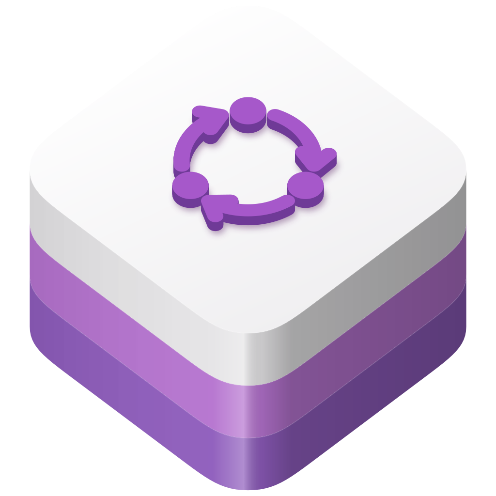

<div align="center">

<p align="center">
  <a href="https://github.com/swift-library/swift-redux"></a>
</p>

<h1 align="center">swift-redux</h1>

<p align="center">
  Manage unidirectional app state with one store, reducers, middleware, and live subscriptions.
</p>

<p align="center">
  <a href="https://github.com/swift-library/swift-redux/actions/workflows/ci.yml"></a>
  
  
  <a href="LICENSE.txt"></a>
</p>

<p align="center">
  <a href="#overview">Overview</a> ·
  <a href="#quick-look">Quick look</a> ·
  <a href="#install">Install</a> ·
  <a href="#usage">Usage</a> ·
  <a href="#requirements">Requirements</a> ·
  <a href="#documentation">Documentation</a> ·
  <a href="#contributing">Contributing</a> ·
  <a href="#license">License</a>
</p>

</div>

## Overview

An action describes a change, and the reducer computes the next value from the previous state. Subscribers receive the current state immediately and every subsequent reduction, including unchanged values; see the [usage guide](Documentation/Reference/Usage.md) for middleware and subscription behavior.

## Quick look

```swift
import Redux

enum CounterAction: ActionType { case increment }
let store = Store<Int>(state: 0, reducer: { action, state in
  let count = state ?? 0
  return action is CounterAction ? count + 1 : count
})
let unsubscribe = store.subscribe { print($0) }
store.dispatch(CounterAction.increment)
unsubscribe()
```

## Install

Add the package and the `Redux` product to `Package.swift`:

```swift
dependencies: [
  .package(
    url: "https://github.com/swift-library/swift-redux.git",
    .upToNextMinor(from: "0.2.0")
  ),
],
targets: [
  .target(
    name: "YourTarget",
    dependencies: [
      .product(name: "Redux", package: "swift-redux"),
    ]
  ),
]
```

swift-redux has no dependencies.

> [!NOTE]
> swift-redux is pre-1.0. Minor releases may include breaking changes, so
> depend on it with `.upToNextMinor(from:)`.

## Usage

Define actions and a reducer, create a store, and retain the unsubscribe closure for each subscription. The [usage guide](Documentation/Reference/Usage.md) covers product selection, middleware, selectors, listener lifetimes, and a complete counter.

## Requirements

- Swift 6.0 or later
- macOS 12 or later, iOS 15 or later, watchOS 9 or later, or tvOS 15 or later

## Documentation

- [Usage guide](Documentation/Reference/Usage.md): examples, behavior, and limits.
- [Module documentation](Sources/Redux/Redux.docc/Redux.md):
  the public API reference and module overview.

- [CHANGELOG.md](CHANGELOG.md) lists notable changes, including changes to
  the public API.
- Doc comments in the source describe `Store`, its protocols, and
  `Middleware`, and Xcode shows them in Quick Help.
- The [Redux documentation](https://redux.js.org) explains the pattern that
  swift-redux follows.

## Contributing

Read [CONTRIBUTING.md](CONTRIBUTING.md) before opening a pull request, and run
`Scripts/check` to check your changes. This project follows the
[code of conduct](https://github.com/swift-library/.github/blob/master/CODE_OF_CONDUCT.md). Releases follow the swift-library
[versioning standard](https://github.com/swift-library/.github/blob/master/VERSIONING.md).

## License

swift-redux is available under the Apache License 2.0 with the Swift Runtime
Library Exception. See [LICENSE.txt](LICENSE.txt) and [NOTICE](NOTICE).
